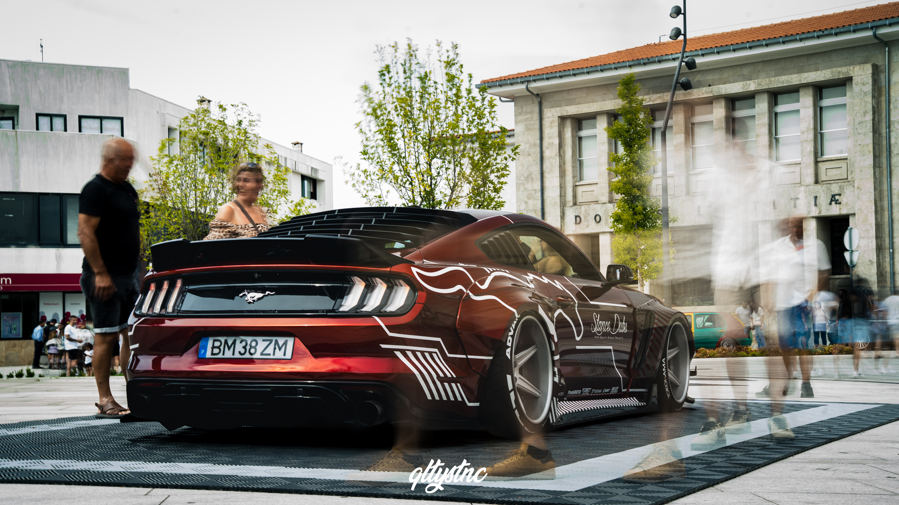
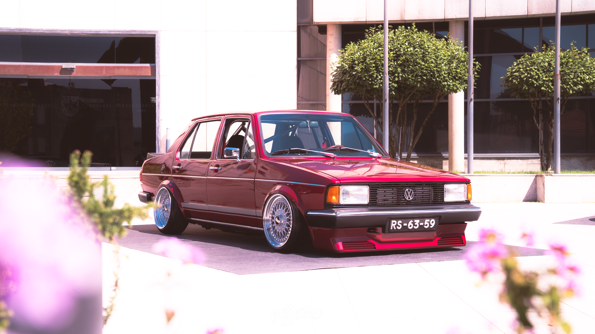
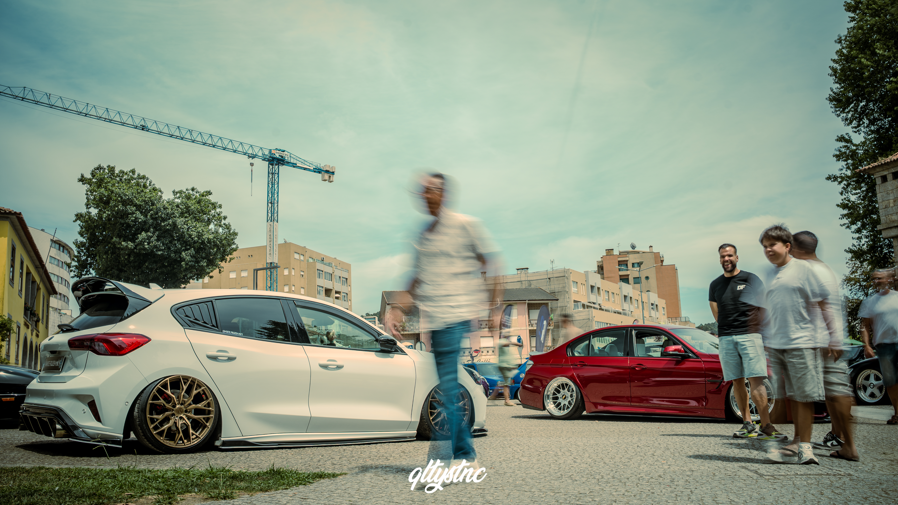
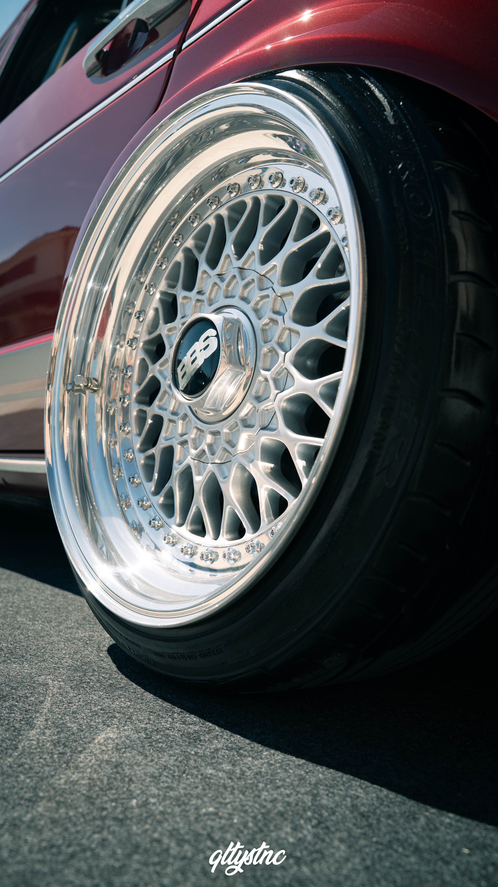
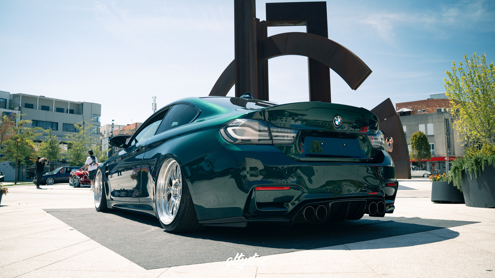
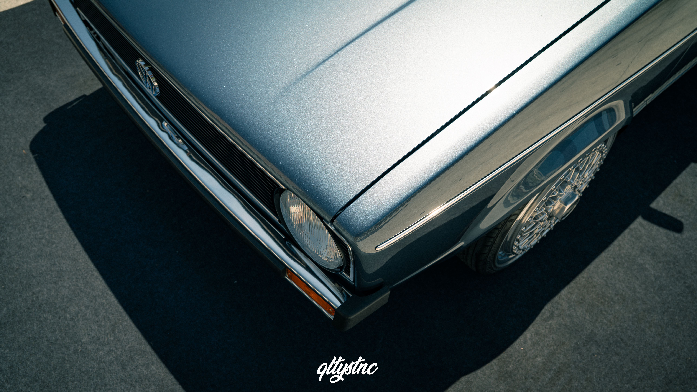
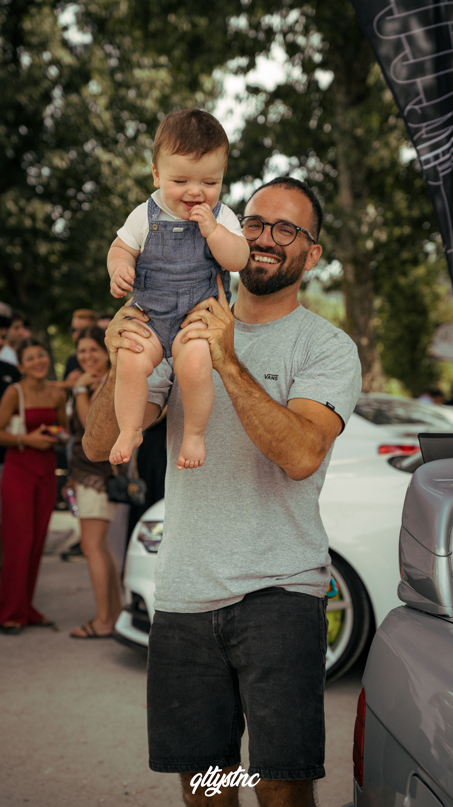

# Summer On Stance V10 – Last Dance

**1 e 2 de Agosto de 2026 — QLTYSTNC**

 

Há eventos que deixam marca. O Summer On Stance foi um deles durante uma década. A décima edição, "Last Dance", assinalou o fim de um dos encontros mais emblemáticos da cultura stance em Portugal — um último fim de semana que reuniu alguns dos melhores projectos nacionais e internacionais, centenas de automóveis e uma comunidade tão forte como sempre.Mais do que uma despedida, esta edição foi uma celebração de tudo o que tornou o Summer On Stance uma referência: qualidade, paixão pelos detalhes e um ambiente que, ano após ano, fez deste evento uma paragem obrigatória para quem vive a cultura automóvel.Para a QLTYSTNC, este fim de semana teve um significado especial — foi o regresso oficial aos eventos, depois de uma prova de drift há poucas semanas ter reacendido a vontade de voltar a fazer isto a sério.

## O regresso

Os últimos anos trouxeram outras prioridades e, sem darmos conta, fomos ficando mais longe dos eventos que durante muito tempo fizeram parte da nossa rotina.

Mas a paixão nunca desapareceu.

Há algumas semanas regressámos à fotografia automóvel durante uma prova de drift e bastou um dia para perceber que a vontade continuava exatamente onde sempre esteve. Quando surgiu a oportunidade de marcar presença no Summer On Stance V10, não houve grandes dúvidas.

Era o momento certo para regressar.

## Um evento que continua a fazer a diferença

Entrar no recinto foi perceber rapidamente porque é que o Summer On Stance conquistou um lugar tão especial entre os entusiastas.

A qualidade dos projectos continua impressionante. Dos clássicos aos modelos mais recentes, das preparações discretas às construções mais ousadas, havia espaço para praticamente todos os estilos. Cada carro mostrava horas de dedicação, atenção ao detalhe e paixão pelo que representa esta cultura.

Mas o verdadeiro destaque continua a ser o ambiente.

O Summer On Stance nunca foi apenas uma exposição de automóveis. É um ponto de encontro onde se reencontram amigos, nascem novas amizades e se passam horas a conversar sobre mecânica, modificações, fotografia e tudo aquilo que une esta comunidade.

Foi precisamente esse ambiente que voltou a fazer a diferença nesta última edição.

## Contar histórias através da objetiva

Percorrer novamente o recinto com a câmara na mão fez lembrar porque é que a fotografia automóvel continua a ser tão especial.

Cada projecto oferece uma nova perspectiva. Há sempre um detalhe escondido, um reflexo inesperado ou uma composição diferente à espera de ser descoberta.

Mais do que fotografar carros, é captar momentos, preservar detalhes e contar histórias através das imagens. E essa sensação esteve presente durante todo o fim de semana.

## O espaço dedicado às lendas

Uma das grandes novidades desta edição foi a criação de uma área dedicada às lendas do Summer On Stance.

Um espaço pensado para homenagear alguns dos projectos e proprietários que acompanharam praticamente toda a história do evento e ajudaram a construir aquilo que o Summer On Stance representa hoje.

Foi um dos locais mais visitados do recinto e uma excelente forma de reconhecer quem, ao longo dos anos, ajudou a elevar o nível da cultura stance em Portugal.

.

## Reencontros que ficam

Os carros foram a razão para lá estar. As pessoas acabaram por ser uma das melhores partes do fim de semana.

Voltámos a encontrar amigos que já não víamos há vários anos e percebemos que algumas conversas simplesmente continuam de onde ficaram.

Houve também uma surpresa inesperada. Várias pessoas reconheceram o nome **QLTYSTNC**, apesar do tempo de ausência. Saber que o trabalho desenvolvido no passado continua presente na memória de quem acompanha esta comunidade só aumenta a vontade de continuar.

São momentos como estes que fazem perceber que esta cultura vai muito além dos automóveis.

## Uma despedida... e um novo começo

Ao longo de dez edições, o Summer On Stance tornou-se muito mais do que um evento automóvel. Tornou-se um ponto de encontro para uma comunidade que cresceu em conjunto, inspirou novos projectos e ajudou a elevar a cultura stance em Portugal.

Se esta foi realmente a última edição, dificilmente poderia ter terminado de melhor forma. O recinto voltou a encher, a qualidade manteve-se ao mais alto nível e o ambiente fez justiça ao legado construído ao longo destes anos.

Para a **QLTYSTNC**, este não foi um ponto final.

Foi um novo começo.

O calendário já começa a ganhar forma, há novos eventos no horizonte e a vontade de continuar a documentar esta cultura é maior do que nunca.

O Summer On Stance chega ao fim, talvez novidades apareçam...

A paixão por esta cultura continua.

E a **QLTYSTNC** estará lá para a contar.

**Fotos & Texto: QLTYSTNC**
