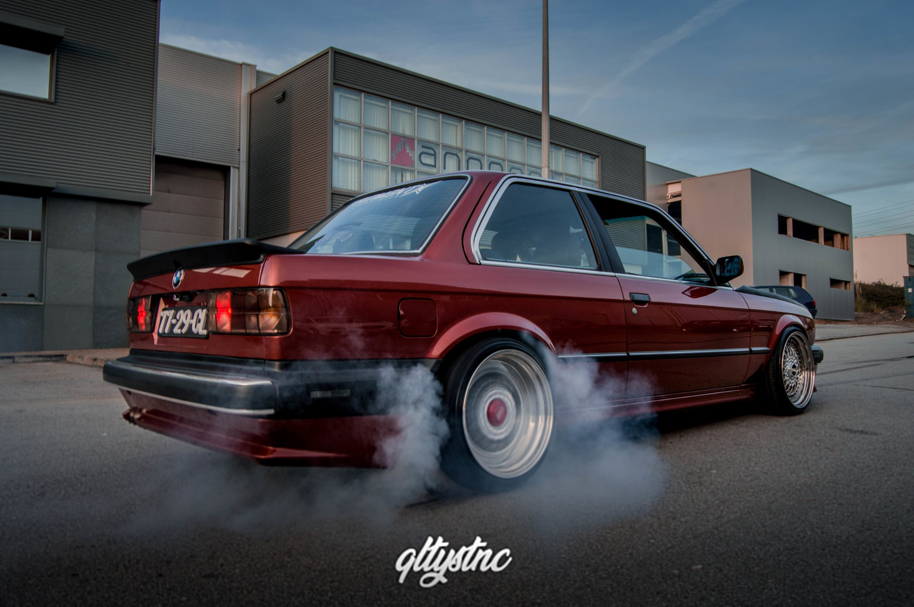
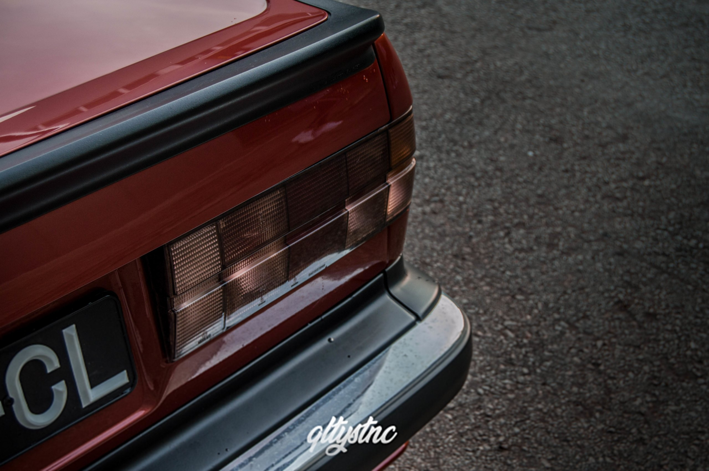
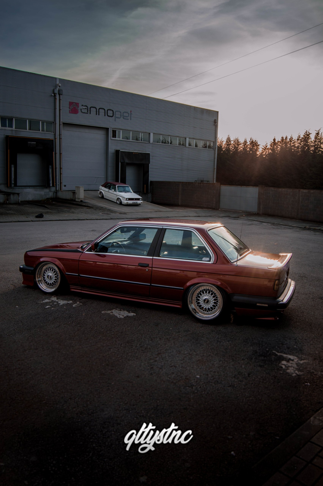
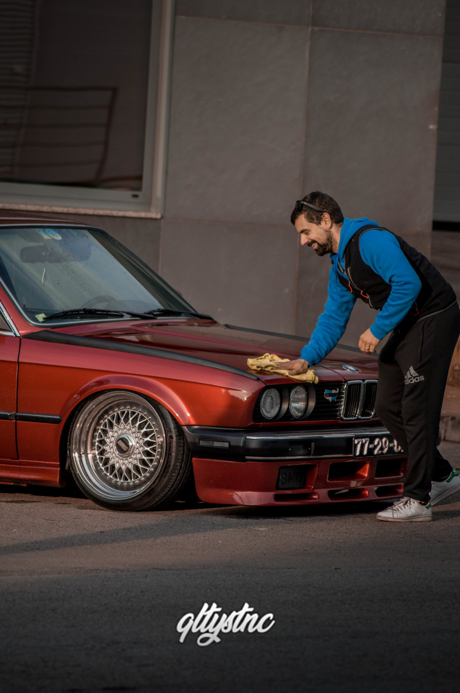
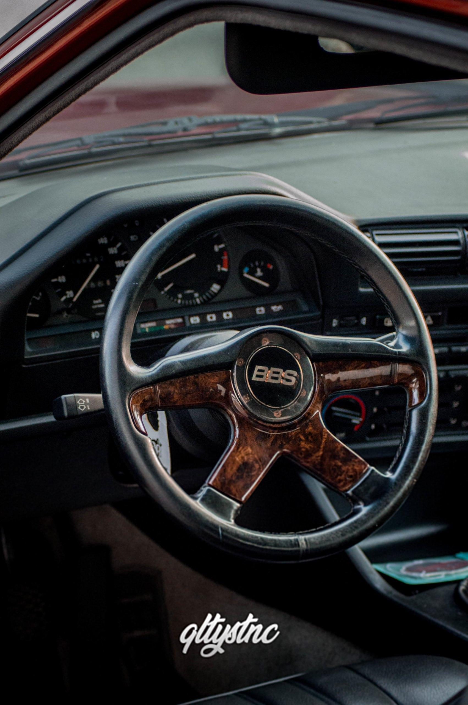

Há uma frase que assenta na perfeição neste projeto: há carros que passam pela história, e há carros que fazem história.

Este E30 passou muito tempo guardado na garagem. Nada foi feito à pressa — cada peça foi planeada, cada passo dado com cuidado, até o carro ficar exatamente como o Luís o imaginava. O resultado é daqueles projetos para os quais se olha e se percebe logo as horas que estão por trás.

## Stance como deve ser

Suspensão a ar **Airlift 3H** e jantes **BBS RS** — uma combinação que dispensa apresentações e que aqui tira um fitment soberbo. Depois, a cor: um tom personalizado com acabamento nacarado, que muda com a luz e faz este E30 destacar-se ainda mais.

## Visual americano, alma europeia

O exterior foi convertido para o visual americano, com peças originais procuradas uma a uma:

- Avental frontal original **US 325is**
- Embaladeiras originais **BMW Touring**
- Avental traseiro original **Zender**
- Side markers e piscas frontais escurecidos
- Aileron original **M-Tech 1**
- Wind splitters **Kamei**
- Farolins **Startec**

Debaixo do capô, o E30 recebeu o swap para o motor **325i**.

## Por dentro

Na altura, o interior ainda era segredo — só pudemos revelar o volante **BBS de 4 braços**, com aro em madeira, que já dava o tom para o resto.

## Feito na Pirigarage

O projeto ganhou vida na **Pirigarage**, onde cada detalhe foi acabado com a mesma paciência que marca todo o carro.

Oito anos depois, continua a ser um lembrete de como é um carro feito com tempo.
