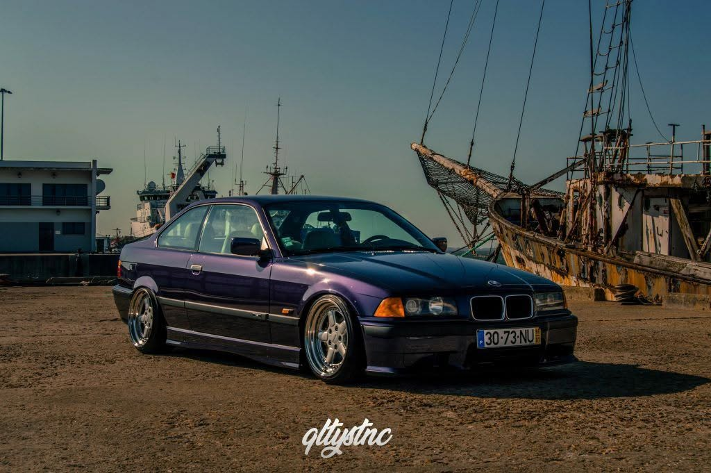
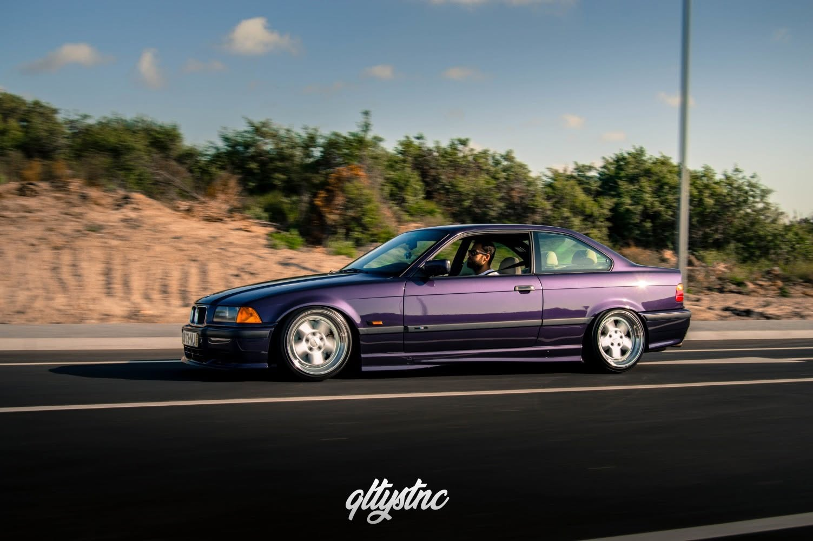
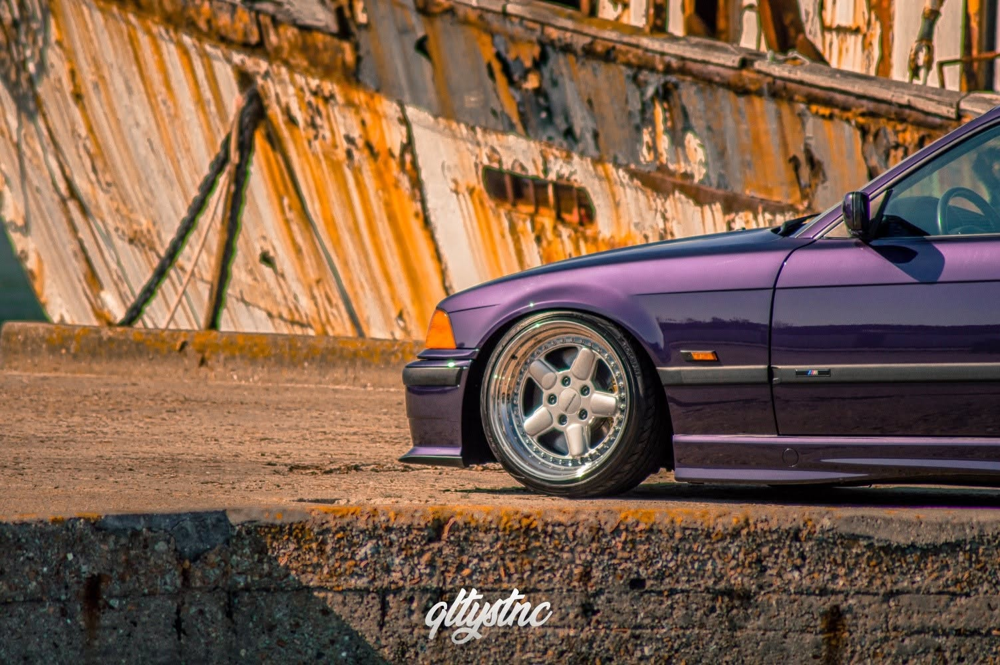
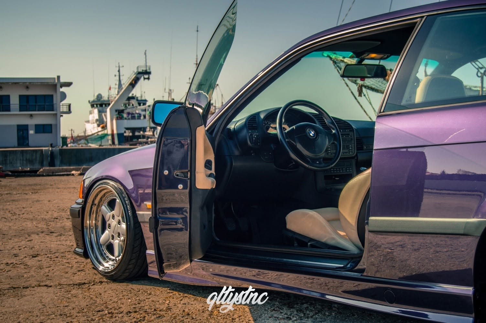
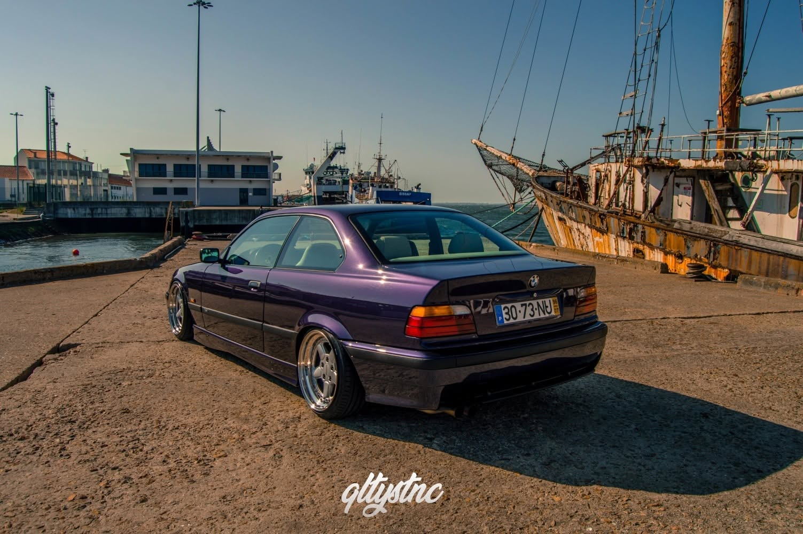
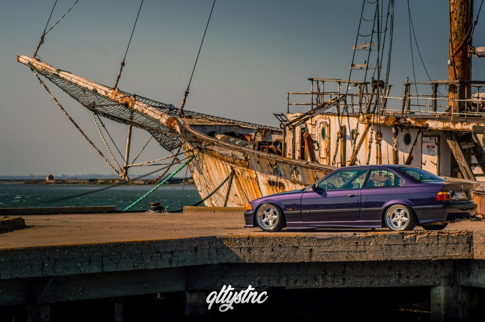
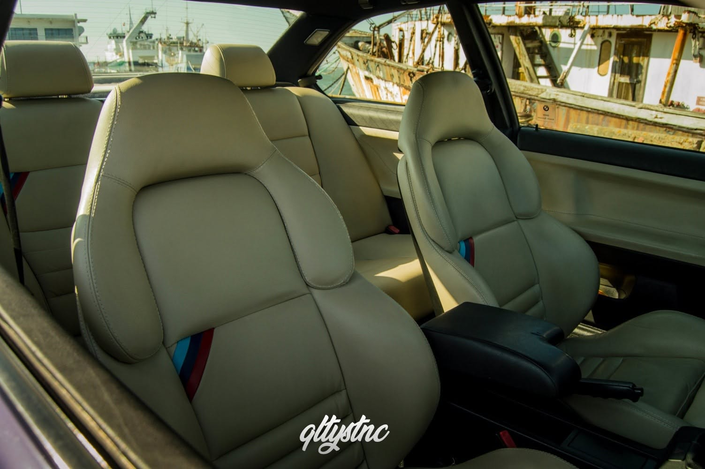
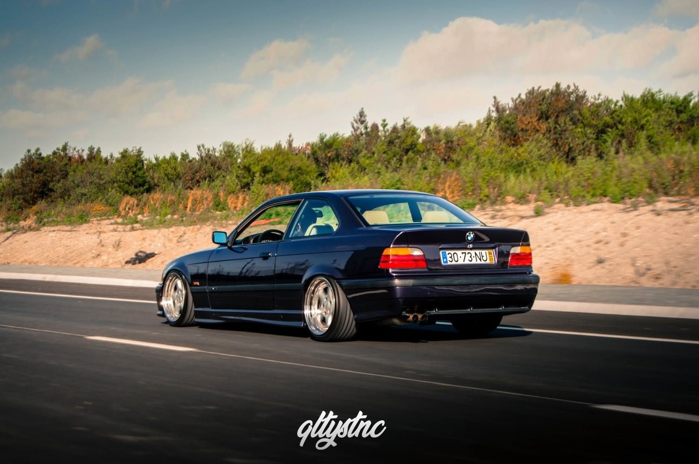

A BMW tinha como desafio criar um carro que sucedesse o bem conceituado E30. O projeto começou a ser estudado desde cedo, e os resultados do grupo Bavarian Motor Works não podiam ter sido mais acertados.

\*"O E36 é provavelmente o carro que ninguém acha que gosta, mas todo o mundo acaba por precisar de ter."\*

Apesar da aceitação inicial dividida entre os amantes da marca, o E36 era um carro adequado às rotinas do dia a dia, com uma frente renovada radicalmente, mas com um peso substancialmente maior (na ordem dos 200kg a mais). Ainda assim, os estudos da BMW tiveram o cuidado de minimizar essa sensação de peso com um aumento de potência, mantendo o rácio kg/cv equivalente ao do E30.

Este aumento de peso deveu-se essencialmente ao crescimento do chassis e ao melhoramento da insonorização com novos e melhores materiais. Contudo, houve também a preocupação de criar um chassis capaz de acomodar um verdadeiro motor M e comportar-se como um verdadeiro M(onstro) na estrada — para isso, aumentou-se a distância entre eixos, distribuindo melhor o peso e melhorando a dinâmica e a mobilidade.

A química deste exemplar foi tão bem estudada que ainda hoje é dos mais usados e desejados pelos amantes do drift.

Talvez por isso mesmo tenha sido apelidado de "The Ultimate Driving Machine".

Um dos maiores prazeres que se retira do mundo dos carros é o convívio e as amizades que se criam.

No Droppt 1.0 tivemos o primeiro contacto pessoal com o E36 do Bryan, mas desde a data do evento que ficámos curiosos para o conhecer melhor — sobretudo todos os detalhes — e fotografar o projeto individualmente.

Em 2019, o E36 do Bryan andou mais ausente dos eventos e, apesar de ter trocado o conjunto de jantes, optou por não se revelar publicamente durante uns tempos. Mas o convite já estava no ar — só faltava uma troca de ideias e o tempo certo para que tudo se enquadrasse.

Na chegada, deparámo-nos com uma rua pacata, de pouco movimento, mas não muito distante do centro da cidade — uma zona piscatória fortemente movimentada pela atividade nela desenvolvida. O E36 do Bryan, em roxo (Techno Violet), destacava-se na rua, e nem foi preciso perguntar o número da porta.

A relação entre o E36 e o Bryan já se estende há alguns anos — o primeiro dono foi o pai do Bryan. Em 1996, o pai comprou o E36 em França, e desde cedo que o Bryan começou a mexer no carro: inicialmente pequenas modificações, que foram evoluindo até ele começar a comprar jantes para o carro — com o pormenor de ainda não ser o dono.

\*"Crescer com o carro dos nossos sonhos na garagem é uma sensação indescritível."\*

Nessa altura, a BMW estava a fazer a transição do E36 da fase 1 para a fase 2, e este é precisamente um exemplar dessa fase de transição.

Um dos "culpados" por este gosto de Bryan pelos carros é o próprio pai, que desde sempre foi um aficionado pela marca e, além deste modelo, já teve outros como o E21.

Com 18 anos, chegou a hora de tomar conta do carro que via desde pequeno no seio da família. Passou a constar como proprietário no livrete, e as modificações ganharam um tom mais sério: desde o interior M estofado em bege, que trazia de origem, até à travagem do E46 330i à frente e E46 320d 150cv atrás. Conta agora também com um volante M-Tech 3 e uma linha de escape completa do 325i, que se fazia ouvir sempre que saíamos de uma rotunda em direção às estradas para fazer as rolling shots.

Com os seus 18 anos, o Bryan já tinha o E36 assim.

Ao longo deste processo, o Bryan decidiu mudar a cor do carro — inicialmente Madeiraschwarz — para Techno Violet, aproveitando que ambas constam como "roxo" no livrete.

Sendo adepto do estilo static, o E36 conta com coilovers e jantes AC Schnitzer de 17", sem spoiler, e com os farolins de nevoeiro para variar o visual. Aos olhos do Bryan, o carro está praticamente completo, mas...

\*"Há algum motivo em especial para usares coils?"\*

\*"Uso coils porque gosto de ajustar a altura e ir para todo o lado assim — há sempre aquele 'será que passa?' ou 'será que chega lá?', mas isso ainda me dá mais prazer. Quanto a bags, pessoalmente não é o meu género, não gosto do aspeto que dá ao carro."\*

\*"Mudavas alguma coisa no teu projeto?"\*

\*"Se mudava alguma coisa? Sim, a parte da mecânica — apesar de já ser um 318is, é o que sinto mais falta, é um upgrade que falta fazer. De resto, está conforme idealizei."\*

O Bryan também relembrou que nem tudo foi um mar de rosas: há cerca de 2 anos, o carro teve de passar pela inspeção B, e contou com a ajuda dos amigos para resolver o problema, já que teve de perder temporariamente a suspensão, a travagem e todo o Pack M, por não constarem nos registos do carro.

Felizmente isso não o desmotivou, e voltou a montar o seu belo E36.

Bryan, certamente nos veremos em breve — até porque as distâncias encurtam-se com as amizades.
