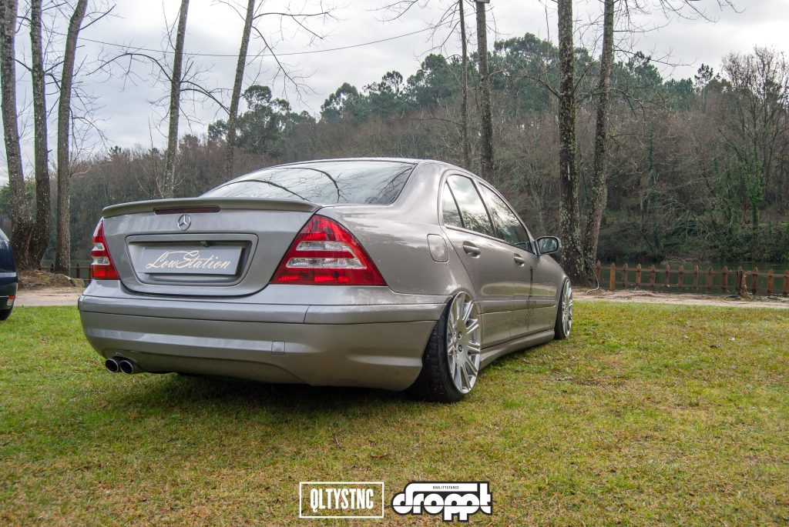
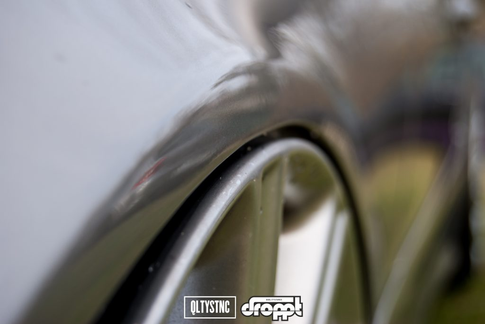
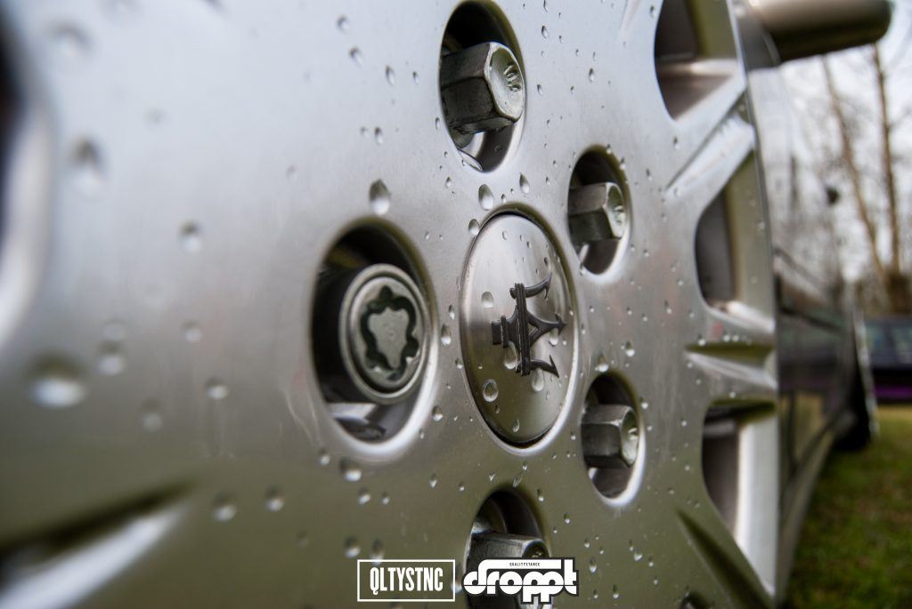
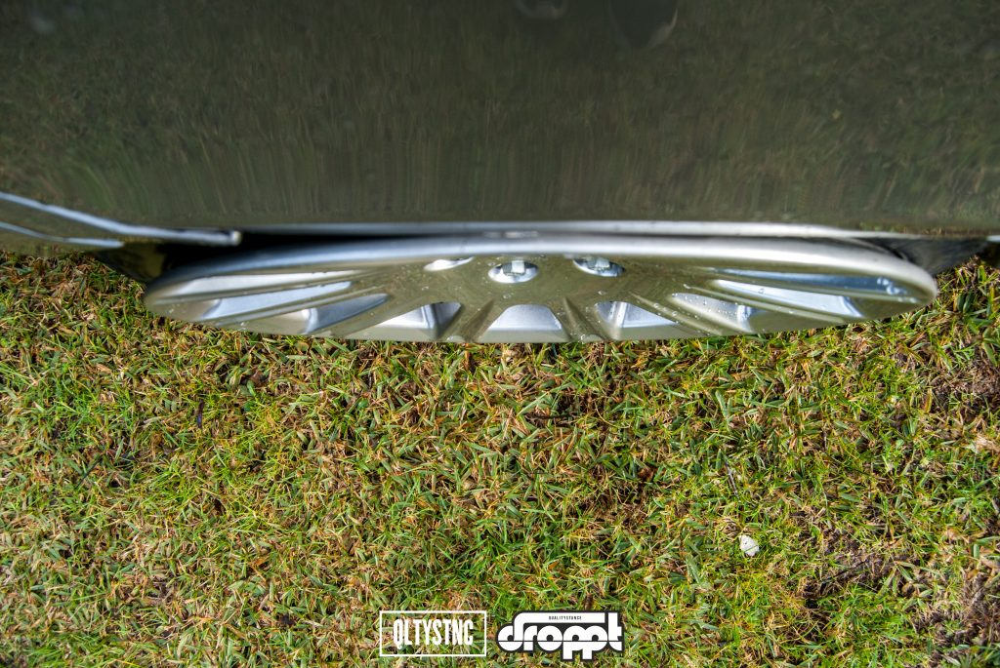
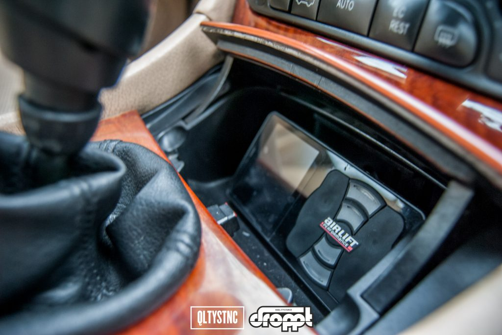
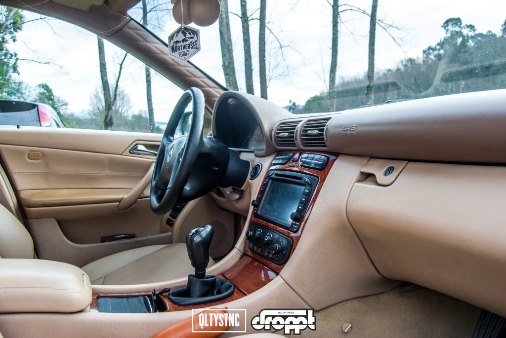
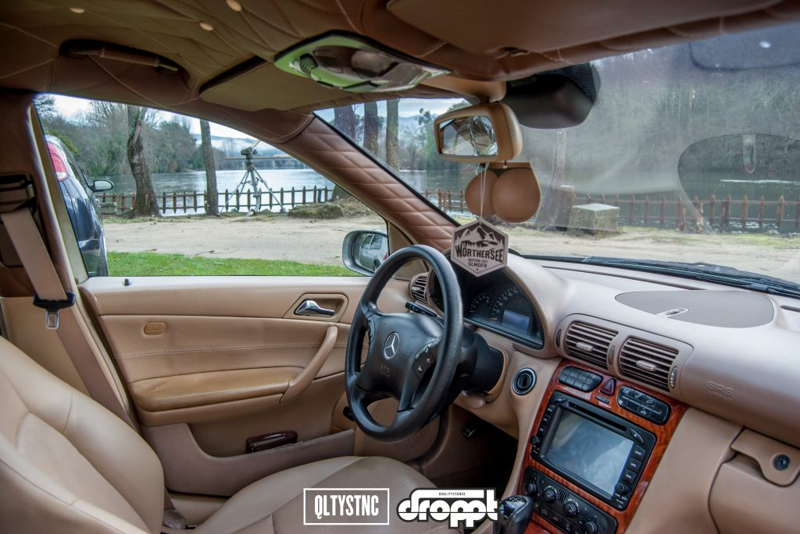
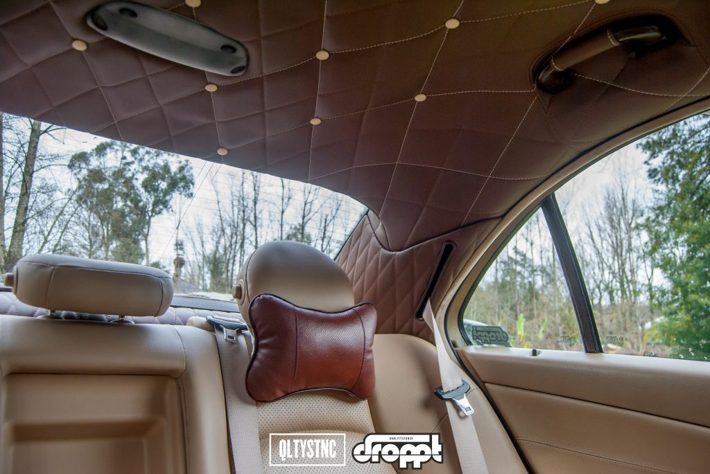
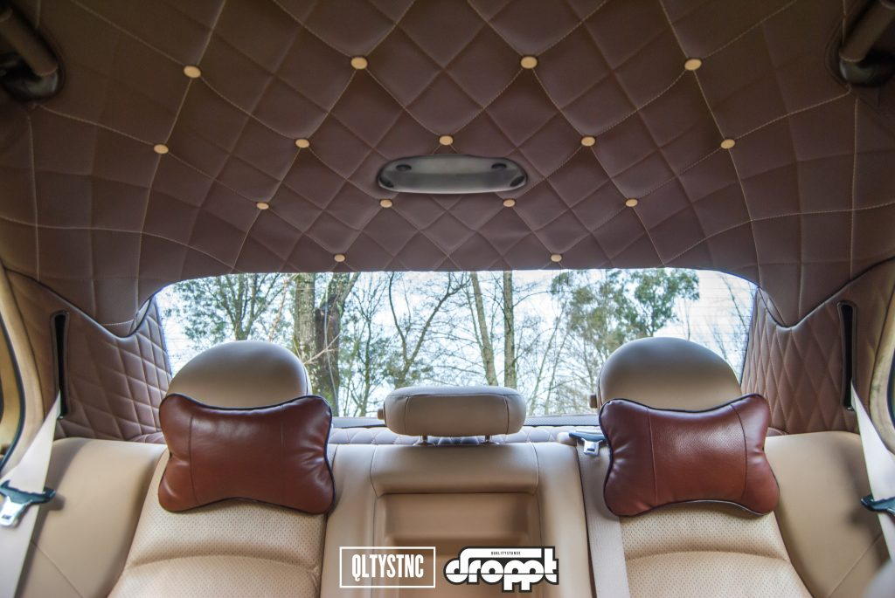
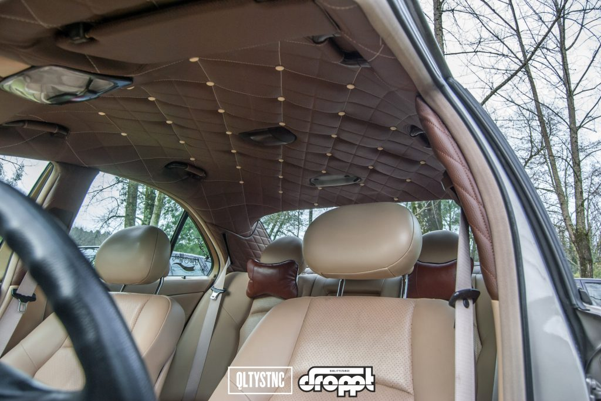

Há carros que nascem para o palco. Este nasceu para trabalhar — e só depois de uma vida inteira na estrada é que descobriu os holofotes.

Este Mercedes W203 passou anos numa praça de táxis. Foi de pai para filho com **1.260.000 km** e, nas mãos do João, ganhou uma segunda vida.

## Um Classe C que rompeu com o passado

A segunda geração do Classe C veio mudar a forma como se olhava para a Mercedes. Herdou a maioria dos motores do antecessor, mas trouxe linhas novas, mais conforto e uma imagem mais jovem. Para quem achava que a marca precisava de se modernizar, o W203 foi a resposta.

O que ninguém esperava era ver um, com mais de um milhão de quilómetros às costas, tão perto do chão.

## A reação do pai

Perguntámos ao João como reagiu o pai quando ele decidiu começar a mexer no carro. Contou-nos exatamente o que aconteceu:

> "O carro está tão bom assim, sempre foi assim, e agora vais mexer nele?"

O tom mudou quando chegaram as primeiras rodas — ainda um jogo de 3SDM:

> "Bonitas. Tiveste gosto…"

## O projeto

Este é o tipo de projeto que divide opiniões. Os puristas da marca torcem o nariz; os outros param para olhar.

O conjunto atual é um jogo de jantes **Maserati de 18"** — 8,5" à frente e 10,5" atrás.

A altura vem da suspensão a ar **Airlift 3P**, alimentada por dois compressores.

Por fora, o João foi buscar à própria família os detalhes certos: **kit AMG**, **travagem AMG**, **spoiler e ponteiras C32** e **panela C30**. O kit do facelift fechou o conjunto e deu ao carro um ar ainda mais atual.

## O interior

Mas é no interior que este W203 mostra a sua classe. Pele bege, apliques em madeira e um tejadilho estofado em capitonê que transforma o habitáculo num pequeno lounge sobre rodas. Deixamos as fotos falar.

## Ficha

- Suspensão montada pela **DMR2**
- Pneus e motor: **3ST Garage**
- Grupo: **LOWSTATION**

## O regresso

Depois de um 2018 afastado da cena, o João deixou-nos uma promessa: voltar em breve. Com um milhão de quilómetros feitos, o W203 já provou que ainda tem muita estrada pela frente.
