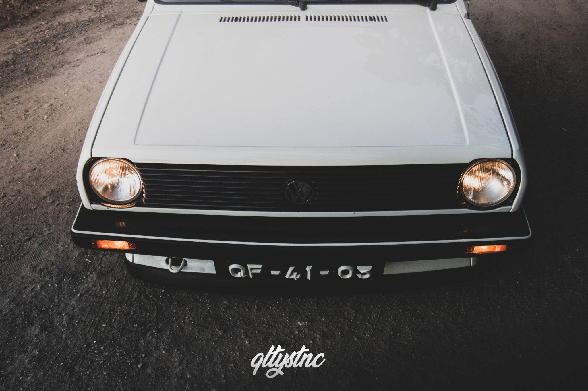
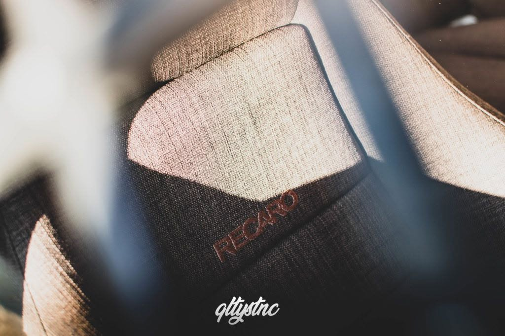
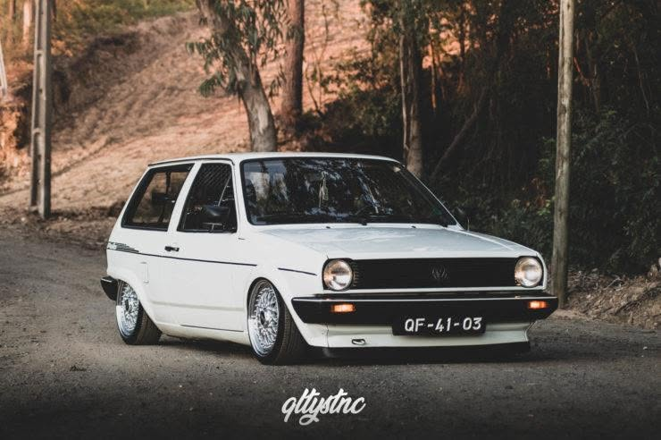
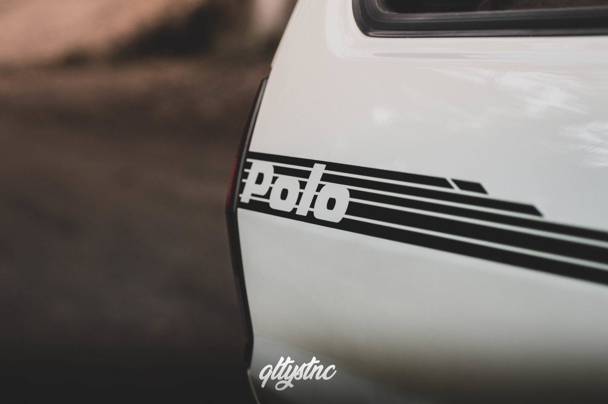
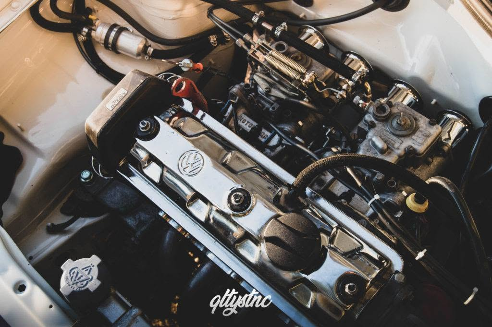
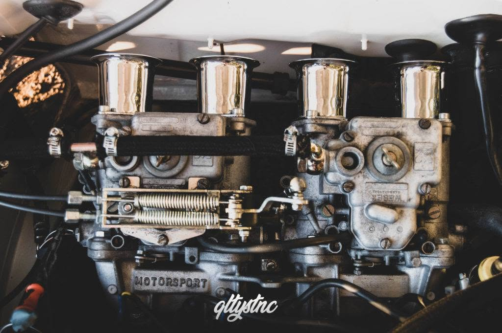
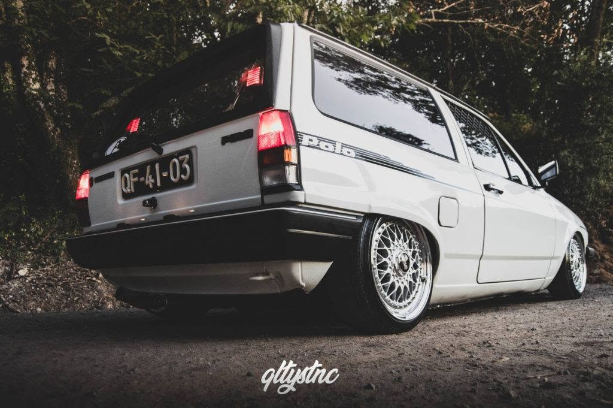
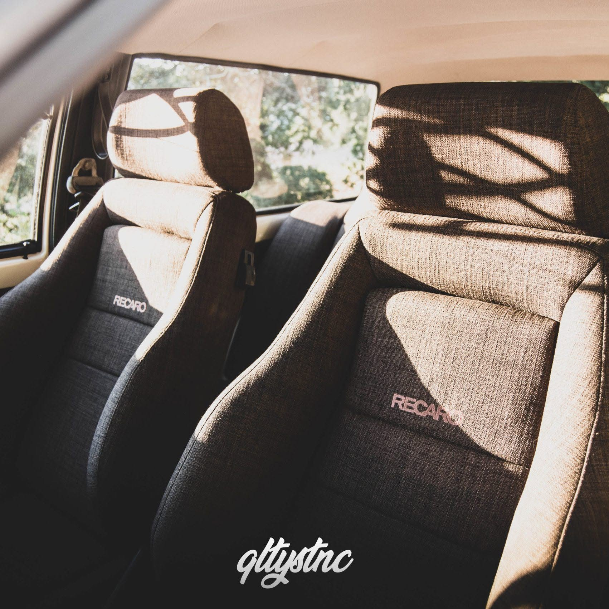

A contar os dias que faltavam para o fim das férias, arranjámos tempo para ver e ouvir uma história cheia de memórias e aventuras. Sem grande preparação ou plano, tirámos fotografias e conhecemos um pouco melhor o homem por trás da máquina.

Entre fotos, boa companhia e muitas histórias, tentámos perceber o que torna este "pequeno" VW Polo Steilheck 86C um projeto único, de Vítor Santos.

Ousado e simples talvez sejam as melhores palavras para descrever esta "carrinha de pão". Uma carroçaria tipo caixa, que guarda todas as memórias e aventuras desde o primeiro dia nas mãos de Vítor até hoje.

O cheiro a gasolina misturado com o som agressivo dos duplos carburadores Weber, aplicados ao pequeno mas enérgico motor 1.0, aguça todos os sentidos e transporta-nos de volta aos loucos anos 80.

Histórias e modificações que Vítor conta com um sorriso que vai além da boca — reflete-se nos olhos. Habituado a fazer quilómetros pela Alemanha, este Polo é a definição mais pura de "uso diário", com tantas aventuras quantos os quilómetros percorridos.

Um carro que nos deixa curiosos sobre como é possível chegar tão longe com "tão pouco".

\> "Vais a conduzir pela estrada, um senhor idoso buzina e faz-te sinal de aprovação... olhas para ele, ele não te conhece de lado nenhum e agradeces... é isso que importa... agora as taças? Estão a acumular pó lá por casa." — Vítor Santos, Canal Youtube Ícones

Segundo Vítor, 2018 foi um ano de redescoberta e apresentações. Vítor passou por eventos por toda a Europa, mostrando que os "pequenos" se encaixam facilmente entre os "grandes" quando o assunto é distinção e notoriedade.

A viagem de eventos começou no VW Days (França), onde Vítor foi chamado ao palco com o Polo para contar a história por trás de todas as aventuras e modificações feitas até então. Próxima paragem? Bélgica, no Retroworks e no VW Village, passando pela Holanda no MIVW, e terminando na terra-mãe da marca, a Alemanha, no Polo Treffen e no Vau-Max.

Mas parece que, em 2018, Vítor achou que um Polo não era suficiente — e decidiu comprar mais um, desafiando-se a ir mais longe nesta nova etapa.

E o Polo que nos traz a este artigo? Com uma vasta gama de mudanças, Vítor não ficou pela estética. Em 2019, renovou o visual desta "carrinha de pão" com suspensão de ar e gestão Airlift 3P, que, segundo o próprio, se revelou uma aposta certeira.

Testes feitos em casa não são do agrado de Vítor — para ele, não há melhor teste do que a estrada. Percorreu 3800 quilómetros de Portugal até à Alemanha, onde vive, passando pela Dinamarca e França. Com uma caixa de 4 velocidades e zero problemas pelo caminho.

Em 2019, a notícia de que ia ser pai outra vez pausou por uns tempos as modificações do pequeno Polo. Mas em 2020, mais organizado e com uma família maior, voltou com o Polo e todas as suas aventuras.

Como em qualquer projeto, todas as peças tinham de estar em harmonia, e Vítor sentiu que faltava algo ao pequeno Polo — foi aí que entraram as atuais jantes BBS RS de 15 polegadas.

Um toque que, na nossa opinião, não pode faltar.

Com vontade de lhe dar um ar mais retro, removeu todos os autocolantes e outras referências ao seu país (exceto a matrícula), deixando apenas o vinil lateral.

Comparando fotos do início com o estado atual, percebe-se que muito foi feito. Algumas mudanças passam despercebidas aos menos atentos — dos pormenores mais pequenos, que só um "olhar atento" nota, como os para-choques em plástico tradicionais, até às mudanças mais ousadas, como o sistema de suspensão de ar ou o interior Recaro. Todos concordamos que este Polo já percorreu um longo caminho, e não parece ficar por aqui.

\*\*E agora, vamos abrir o capô?\*\*

\- Motor 1.0, 33kW (ref. AAK)

\- Duplos carburadores Weber

\- Caixa de velocidades original, 4 relações

\- Linha de escape e coletores em aço inoxidável

\- Radiador de água em aço inoxidável, com anulação do vaso de expansão

O motor foi refeito de raiz e, mais uma vez para ser diferente, Vítor manteve o pequeno 1.0 em vez do ousado 1.3 turbo, que tinha sido planeado anteriormente. Num "mundo" onde via outros a mudar para o motor 1.3, quis manter-se o mais fiel possível à história do carro e preservar a originalidade.

Foi uma sessão difícil de agendar dado o panorama mundial da altura, mas no meio das coisas más, coisas boas podem acontecer — e Vítor teve de prolongar a estadia em Portugal, dando-nos tempo para fazer a sessão nos termos que exigimos de nós próprios.

Sabemos que a diferença está nos pequenos detalhes, e o nosso compromisso é registá-los.

O interior foi outra aposta positiva, com gosto pelo detalhe. Mesmo simples, sem grandes aventuras ou exageros, este interior destaca-se pela qualidade. Com quase todas as peças mudadas para castanho (uma cor inicialmente questionada quanto à forma como assentaria no carro), adquiridas na sua maioria na Alemanha, o resultado final prova mais uma vez ser a escolha certa.

Sabemos que a história não fica por aqui, e o mais certo é as nossas lentes voltarem a cruzar-se com este projeto. E quem sabe, nesse dia, as surpresas venham num formato diferente, tentando retratar momentos que ainda faltam partilhar neste projeto que, embora pequeno, está cheio de "espírito".
